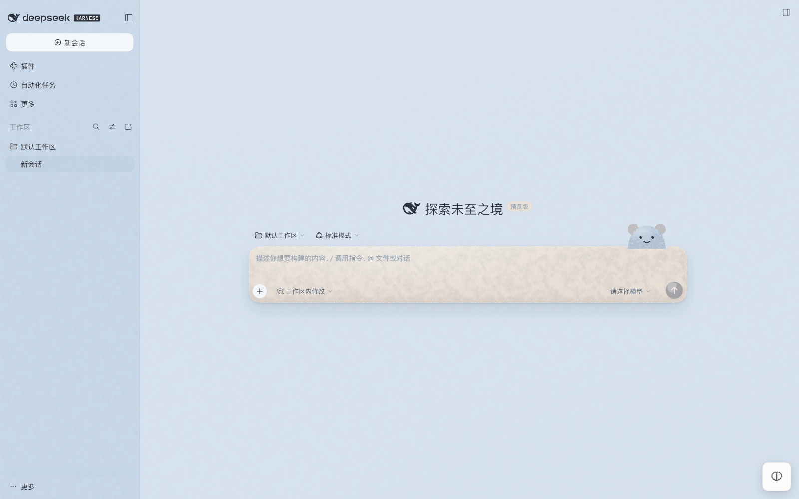
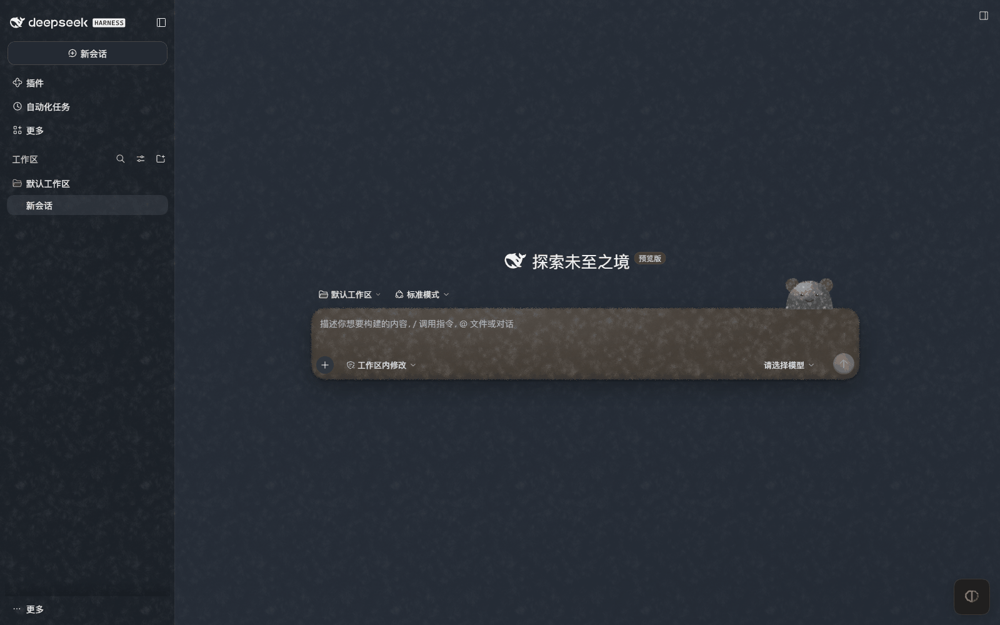

# Muse Plush · Muse 毛绒

A plush-toy skin for the DeepSeek Harness Web GUI. The whole window becomes powder-blue pile, the bubbles and composer turn into a beige plush belly with fuzzy edges, brand marks become brass buttons, and a small plush Muse lounges on the composer — with its own lights-out version for dark mode.

> Fan-made skin. Not affiliated with DeepSeek, Meta or the Muse product. See [NOTICE](NOTICE).



## 它长什么样

- **身体**：整个窗口是粉蓝色长绒；侧栏直接露出绒毛，对话区盖一层半透明的浅蓝，读字不累。
- **肚皮**：用户气泡、输入框是灰米色肚皮绒，边缘经 SVG 位移滤镜变成毛茸茸的毛边（文字不受影响）。
- **纽扣**：品牌色与发送键是深棕色纽扣。
- **小团子**：输入框右上角趴着一只 Muse，会眨眼、轻轻晃。
- **夜间**：同一只 Muse 关了灯，深蓝灰绒 + 暗米色肚皮。

绒毛纹理不打包任何图片：启动时用 canvas 现画（按簇生成的上万根短纤维 + 绒团明暗，无缝平铺），是一张灰度半透明贴图，所以毛色可以随便换。



## 安装

```bash
# 市场里点「安装」用的就是这条
dsh plugin add https://github.com/zhule33-cmyk/muse-plush-skin/releases/download/v1.0.0/dsh-client-ui-skin-muse-plush-1.0.0.tgz
```

装完重启 DSH 生效。要指定 profile 时加 `--profile <名称>`；桌面端的 `desktop` profile 由 Electron 独占管理，CLI 会被拒绝，请在 DSH 里「设置 → 插件」安装，或在终端里装到别的 profile 试用。

还没发 npm；以后发到 npm 后可以简写成 `dsh plugin add dsh-client-ui-skin-muse-plush`。

- 和 `@smalltailqwq/dsh-client-ui-skin-deep-whale-manager`（皮肤管理）配合最好：装好后在「设置 → 皮肤管理 → Muse 毛绒」里开关小团子、毛边，调绒长和毛色。
- 不装皮肤管理也能用，只是默认开满（小团子开、毛边开、标准绒长、默认毛色）。
- 皮肤是全局覆盖型，同一时间只该启用一个皮肤包；换皮肤先禁用别的皮肤行。

## 设置

装了皮肤管理时，可在「设置 → 皮肤管理 → Muse 毛绒」里调：

| 项 | 说明 |
| --- | --- |
| 输入框上的 Muse 小团子 | 开 / 关 |
| 毛边 | 气泡与输入框的毛茸茸边缘，开 / 关 |
| 绒毛长度 | 短绒 / 标准 / 长绒 |
| 毛色 | 默认 `#B7CBE2` |
| 耳朵 / 肚皮色 | 默认 `#D2C4B6` |

## 卸载

```bash
dsh plugin --profile <你的 profile> remove dsh-client-ui-skin-muse-plush
```

或在皮肤管理里切回其它皮肤（不用卸载），重启后生效。

## 兼容性

- DSH Web 界面 0.2.2-rc 系列（`dshCompatibility: 0.2.2rc1`）。只依赖 `--dsw-*` 主题 token 和稳定的 DOM 类名，不 import 任何 Harness 客户端包。
- 只用 `body[data-dsh-muse-plush]` 作用域内的样式，卸载后不残留。

## License

MIT，见 [LICENSE](LICENSE)。
